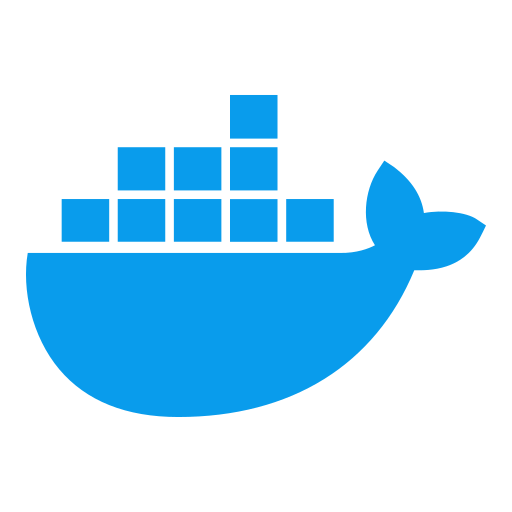

<!-- Bioluminescent Deep-Sea Animated Hero Banner -->

 

<!-- Dynamic Typing Terminal -->

 

<!-- Two-Tone Hero Action & Live Metric Badges -->

 

<!-- About Me + Developer Coding GIF -->
##  Hey there, I'm Nguyễn Văn Hải!

- 💻 **Full-Stack & Creative Developer** specializing in high-craft interfaces, spatial 3D scenes, and resilient backend services.
- ✨ **Frontend & Motion Engineering:** crafting responsive UIs with **Next.js, React, TypeScript & Tailwind CSS** powered by **60fps GSAP, ScrollTrigger, Three.js & GLSL WebGL**.
- ⚙️ **Backend & Infrastructure:** designing clean APIs and data flows with **Node.js, Express, FastAPI, PostgreSQL, MongoDB, Redis, Docker & Nginx**.
- ⚡ **Philosophy:** obsessive about fluid micro-interactions, clean system boundaries, and production polish.
- 🌐 **Portfolio & Inquiries:** explore more at [undowhai.id.vn](https://undowhai.id.vn) or drop a message at **nguyenvanhai.01256@gmail.com**.

 

## ⚡ Tech Stack & Live Arsenal

<!-- Moving Tech Logos Showcase (GIFs + Animated SVGs) -->

  &nbsp;&nbsp;
  &nbsp;&nbsp;
  &nbsp;&nbsp;
  &nbsp;&nbsp;
  &nbsp;&nbsp;
  &nbsp;&nbsp;
  &nbsp;&nbsp;
  &nbsp;&nbsp;
  &nbsp;&nbsp;
  &nbsp;&nbsp;
  &nbsp;&nbsp;
  

<!-- Dual-Row Counter-Scrolling Neon Capsule Marquee -->

<!-- Bold Capability Strips -->

  
  
  
  
  
  
  

  
  
  
  
  
  

  
  
  
  
  
  
  

  
  
  
  
  
  
  

## 🐍 Contribution Snake & GitHub Analytics

<picture>
  <source media="(prefers-color-scheme: dark)" srcset="./assets/profile/github-snake-dark.svg" />
  
</picture>

  

 

 

 

 

## 🌐 Let's Connect & Build

  

